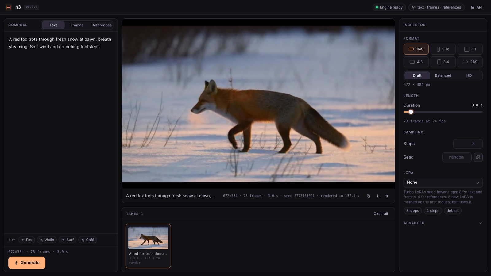

# h3-rs

MiniMax H3 text/image → video **with stereo audio** in Rust (candle + CUDA). It is a port of ComfyUI's
implementation (`comfy/ldm/minimax`, `comfy_extras/nodes_minimax_h3.py`) and loads the ComfyUI model
files as-is:

| file (ComfyUI `models/…`) | format | handled by |
|---|---|---|
| `diffusion_models/minimax_h3_fl2va_pruned_int8_convrot.safetensors` | int8 per-row + ConvRot (Hadamard-256) | `dit.rs` |
| `text_encoders/qwen3vl_32b_minimax_h3_nvfp4_awq.safetensors` | NVFP4 (swizzled fp8 block scales) + AWQ, int8 embeddings | `text.rs` |
| `vae/minimax_h3_video_vae_fp16.safetensors` (or the int8_convrot variant) | fp16 | `vae_video.rs` |
| `vae/minimax_h3_audio_vae_fp32.safetensors` | fp32 | `vae_audio.rs` |
| `loras/*.safetensors` (optional) | ComfyUI LoRA, incl. PDD head-bank `reshape_weight` | `lora.rs` |

Quantized weights stay quantized in memory and are dequantized per layer by NVRTC kernels (`kernels.rs`).

## Install

Packages for Arch, Debian/Ubuntu and Homebrew on Linux x86_64, release archives and the website live at
[h3-rs.apiplant.com](https://h3-rs.apiplant.com); see [`packaging/`](packaging/README.md). Or from source:

```sh
cargo install h3-rs            # needs the CUDA 13 toolkit (nvcc) and ffmpeg at run time
```

## Build

Needs CUDA 13.x, ffmpeg, Rust 1.97 or newer. `.cargo/config.toml` pins `CUDARC_CUDA_VERSION=13040`.

```sh
(cd ui && pnpm install && pnpm build)   # the web UI that `h3 serve` embeds (skipped: `/` then says how to build it)
cargo build --release                   # first build compiles flash-attn (~15 min); --no-default-features --features serve skips it
```

## Use

```sh
# text -> video+audio (defaults: 1344x768, 124 frames ≈ 5.2 s, 20 steps, res_multistep)
./target/release/h3 generate -p "A red fox trots through fresh snow at dawn, crunching footsteps." -o fox.mp4

# first (and/or last) keyframe: the canvas follows the image's aspect ratio at --megapixels (default 1.0,
# like ComfyUI's ImageScaleToTotalPixels); --width/--height/--aspect 9:16 override, --fit stretch|crop
./target/release/h3 generate -p "..." --image first.png --last-image last.png

# reference to video (ref2va checkpoint is picked automatically). Tags are numbered per type in this order:
# images, then videos (a video's soundtrack is the <Audio j> just before its <Video k>), then --ref-audio files.
./target/release/h3 generate -p "<Picture 1> walks through the scene of <Video 1>, speaking with the voice of <Audio 2>" \
    --ref-image person.png --ref-video scene.mp4 --ref-audio voice.wav        # --ref-video-mute, --ref-image-size max

# official turbo LoRAs (Comfy-Org/MiniMax-H3 loras/): 8 steps fl2v, 4 steps ref2v
./target/release/h3 generate -p "..." --lora minimax_h3_fl2v_turbo_8step_v1.0_comfyui_bf16.safetensors --steps 8
./target/release/h3 generate -p "..." --ref-image a.png --lora minimax_h3_ref2v_turbo_4step_v0.1_comfyui_bf16.safetensors --steps 4

# re-decode saved latents
./target/release/h3 generate -p "..." --save-latents run.safetensors
./target/release/h3 decode run.safetensors -o run.mp4
```

Models resolve under `--models-dir` (env `H3_MODELS_DIR`; default `./models` or `~/ComfyUI/models` if present, else `~/.cache/h3-rs/models`). Override
individual files with `--dit`, `--text-encoder`, `--video-vae`, `--audio-vae` (name or path).
Frame counts snap up to the model's 17k+5 grid at 24 fps; sizes snap to multiples of 32. Noise matches ComfyUI's
`RandomNoise` (torch mt19937 `randn`, video then audio from one generator), so a seed gives the same starting
latent as in ComfyUI.

## Server



`h3 serve` keeps every model loaded (text encoder and VAE decoder streamed from RAM, DiT blocks filling the
rest of the GPU) and renders requests one at a time:

```sh
./target/release/h3 serve --addr 127.0.0.1:8188 --lora minimax_h3_fl2v_turbo_8step_v1.0_comfyui_bf16.safetensors --steps 8
curl -o out.mp4 -H 'content-type: application/json' localhost:8188/v1/generate \
  -d '{"prompt": "A red fox trots through snow", "seconds": 5, "seed": 3}'
```

`POST /v1/generate` takes JSON: `prompt` (required), `width`, `height`, `megapixels`, `aspect`, `seconds` or
`length`, `steps`, `seed`, `sampler`, `shift_video`, `shift_audio`, `image` / `last_image` (base64, `data:` URLs
accepted), `fit`, `ref_images` / `ref_videos` / `ref_audios` (base64 lists), `ref_video_mute`, `ref_image_size`,
`lora` (file name in `models/loras`, `"none"` to disable the server default), `lora_strength`, `crf`. It returns
`video/mp4`. `GET /` is a web studio (text / keyframes / references, live progress, takes; source in `ui/`, embedded in the binary),
`GET /v1/info` lists models, memory settings, available LoRAs and queue length, `GET /v1/status` reports the stage and
step of the running request, `GET /openapi.json` and `GET /docs` describe the API, `GET /health` returns `ok`. A warm 8-step 640×352 request takes about 12 s end to end.

## Speed (RTX 4090, one DiT step)

| | ComfyUI | h3-rs |
|---|---|---|
| 1344×768, 124 frames | 15.6 s | 13.0 s |
| 640×352, 56 frames | 0.47 s | 0.52 s |

What makes it fast:

- int8 weights run on int8 tensor cores: a fused int8 GEMM (`attn8.rs`, 128×128 tiles, 3-stage cp.async,
  grouped rasterization) quantizes activations per row and writes bf16 directly; the ConvRot Hadamard rotation is
  done warp-level inside the quantizer; fc1's gate/up rows are interleaved at load so SwiGLU fuses into its epilogue
- DiT attention: int8 Q·Kᵀ / fp16 P·V flash kernel (≈1.25× flash-attn 2 at full size)
- LoRAs are merged into the int8 weights at load (dequantize, add, requantize), so they cost nothing per step
- fused RMSNorm + adaLN modulate; streamed blocks upload on a second CUDA stream from pinned RAM; the CUDA memory
  pool keeps freed buffers

Switches: `H3_INT8=0` (bf16 GEMMs), `H3_GEMM=cublaslt` (cuBLASLt int8 + separate epilogue), `H3_ROT=gemm`
(separate rotation), `H3_ATTN=flash`, `H3_LORA_RUNTIME=1` (unmerged low-rank LoRA path), `H3_PROFILE=1`
(per-op times each step).

## Memory configurations

Choose a preset with `--preset`, load a TOML file with `--config configs/x.toml`, or override single knobs
(`--dit-gpu-blocks`, `--te-gpu-layers`, `--offload ram|disk`, `--mlp-chunk`). Run `h3 presets` to print them.

| preset | target | DiT blocks on GPU | TE layers on GPU | non-resident weights | notes |
|---|---|---|---|---|---|
| `gb24` (default) | 24 GB GPU, ≥48 GB RAM | auto (fits free VRAM) | 50/50 | RAM (pinned) | |
| `gb16` | 16 GB, ≥32 GB RAM | 14 | 30 | RAM | |
| `gb12` | 12 GB, ≥32 GB RAM | 4 | 16 | RAM | |
| `gb8` | 8 GB, ≥16 GB RAM | 0 | 4 | disk (mmap) | measured peak 6.5 GB at 1344×768×124f |
| `minimal` | smallest GPU | 0 | 0 | disk | VAE decoder streamed too, small chunks |
| `auto` | anything | fits free VRAM | fits free VRAM | RAM | `reserve_gb` kept for activations |

Knobs (`[memory]` table):

- `dit_gpu_blocks` / `te_gpu_layers`: resident layers; the rest upload every step (DiT ≈0.39 GB/block, TE ≈0.31 GB/layer). `-1` = auto.
- `offload = "ram" | "disk"`: `ram` copies non-resident weights into process memory (most RAM, steady speed);
  `disk` reads them from the mmapped file each use (minimal RAM; fast while the OS page cache holds them).
- `sequential`: each model is freed before the next stage loads (TE → DiT → VAEs).
- `token_chunk`, `mlp_chunk`: rows per GEMM / MLP chunk; this is what bounds activation memory at large sizes.
- `vae_tile_batch`, `vae_resident`, `vae_dtype`: the VAE decodes all 256 px tiles of a 17-frame chunk layer by
  layer, so a streamed decoder costs one weight pass per chunk.

Streamed weights upload while the previous layer computes, so at large sizes the low-VRAM presets cost little as long
as RAM (or the page cache) holds the weights. If RAM is short, disk reads dominate.

## Validation

`tools/ref_*.py` dump reference tensors from ComfyUI, and `parity` (`src/bin/parity.rs`) compares against them:
dequant (int8 exact, NVFP4 bf16-exact), text encoder (token ids and tags identical, hidden cos 0.99998 text /
0.9996 with image), DiT block outputs (cos ≥ 0.99997 for early blocks; bf16-level drift over 50 blocks), video VAE
decode (cos 0.999998) / image encode (0.99998) / 22-frame encode (0.99999), audio VAE decode (cos 0.999998) /
encode (0.99992).

## Not yet ported

`MiniMaxH3AddGuide` clips/audio at arbitrary frames, Fun ControlNet, denoise masks. The older
`MiniMax-H3-FL2VA-Acc-8Step_comfy` LoRA targets adaLN at a width the pruned "curve" checkpoint doesn't have; those
targets are skipped (as in ComfyUI). Prefer the official turbo LoRAs, which only touch attention/MLP.
